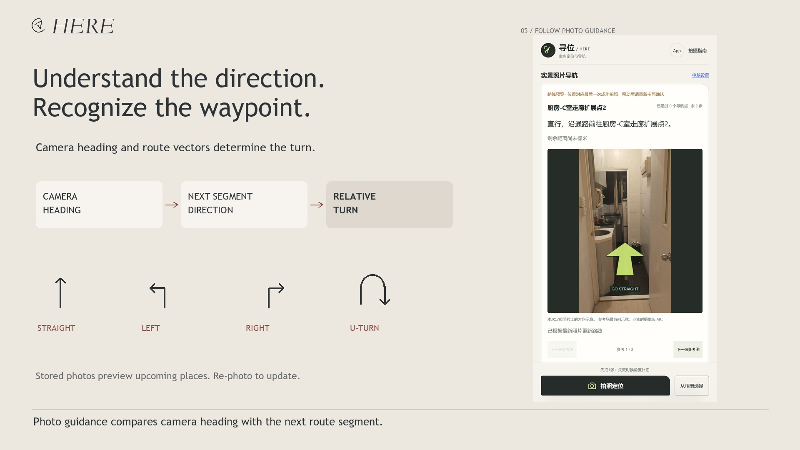

# HERE · Indoor visual localization and navigation

A Windows prototype that reconstructs an indoor scene from phone video, estimates camera position and heading from a new photo, and provides visual route instructions on real scene photographs. The mobile web interface connects to the Windows host over a local network.

## Demo

[Explore a successful recorded journey](https://kugel-m.github.io/Here/recorded-case.html) — click through the input photos, computed poses, saved route, straight-ahead guidance and arrival match. This uses recorded engine outputs and does not run a new localization in the browser.

[Watch the updated English technical demo · 1:29](https://kugel-m.github.io/Here/technical-demo.html) · [Download 1080p MP4](docs/media/technical-demo.mp4) · [English subtitles](demo/English_Subtitles.srt) · [Narration](demo/English_Narration.md)

[](https://kugel-m.github.io/Here/technical-demo.html)

The video shows the working application's photo localization, destination selection, A* route planning, static scene arrows and re-localization. The revised video uses fresh high-resolution application captures and registered mapping-photo replays through the real engine. It presents a controlled demonstration. NFC anchors are planned as optional support; AI glasses and cultural discovery scenes are future concepts. [Music attribution](demo/Music_Credits.md).

## Cultural experience demo

**Hong Kong, one stop at a time.** A final team-edited film follows a visit to a Hong Kong dai pai dong, where a “Tap for a story” marker invites a visitor to discover local culture. This presents HERE's proposed cultural experience alongside the working wayfinding prototype above.

[**Watch the cultural demo in your browser · 1:43**](https://kugel-m.github.io/Here/cultural-demo.html) · [Introduction and scope](demo/cultural/README.md) · [Download the updated film](https://github.com/Kugel-M/Here/releases/download/cultural-demo-v2/Cultural-demo-updated-20261023.mp4)

[](https://kugel-m.github.io/Here/cultural-demo.html)

## Presentation script

[Read the English presentation script](https://kugel-m.github.io/Here/presentation-script.html) · [Download the original Word document](docs/files/Find_and_Feel_English_Script.docx)

Slide-by-slide speaker notes for the final 22-slide Find and Feel deck, including timing, video cues and optional Q&A support.

## Run the application

See **[the Windows setup and operation guide](indoor_mapper_mvp/README.md)**. Requirements are Windows 10/11, Python 3.12 (64-bit), COLMAP and the Python dependencies in `indoor_mapper_mvp/requirements.txt`.

```powershell
cd indoor_mapper_mvp
py -3.12 -m venv .venv
.\.venv\Scripts\python.exe -m pip install -r requirements.txt
```

Set the installed COLMAP executable path in `config.json`, then run `app.py doctor`. Start the desktop interface with `Start.cmd`. With the sample map installed, `Start-Demo-Mobile.cmd` starts the mobile interface and prints a fresh LAN access URL. Do not start a second service on the same port.

**[Download the prebuilt map and full evidence package from Releases](https://github.com/Kugel-M/Here/releases/latest).** Extract the package and copy its `03_Application/indoor_mapper_mvp/projects/` and `demo_inputs/` folders into the application's folder. The large map database, original runtime environment and existing access credentials are not stored in Git history. You can also build a new map from your own video.

## Prototype proofs

- [Two editable English proof slides with embedded video](pitch-deck/HERE_Prototype_Proofs_EN.pptx)
- [Static PDF proof slides](pitch-deck/HERE_Prototype_Proofs_EN.pdf)
- [Eight actual application captures](docs/app-captures/)
- [English translation reference for the Chinese UI](docs/UI_English_Translation.md)
- [Architecture and recorded results](docs/Architecture_and_Evidence.md)
- [Technical links and upstream repositories](docs/Technical_Links_and_Repositories.md)
- [Recorded camera pose](docs/recorded_pose.json)

## Technical flow

Phone video → FFmpeg frame selection → COLMAP sparse SfM map.

New photo → feature matching and query registration → camera XYZ and orientation → independent navigation graph → destination lookup → A* route → turn instructions and static scene-photo arrows.

New photos re-run localization and update, replan or pause navigation. Previewing a later reference image does not advance the measured position.

## Evidence and scope

The demonstrated map contains 141 registered cameras and 35,040 sparse points. The recorded corridor-photo run passed the geometric checks with 68 valid 2D–3D correspondences and a median reprojection error of 1.68 pixels. That is an image-space consistency measure, not a measured physical position error. The candidate navigation graph has 13 nodes and 12 connections.

Coordinates are in the original COLMAP frame with arbitrary scale. Metric calibration and passable-route verification remain required. The old floorplan overlay is an estimate; the independent navigation graph operates on the original 3D pose. Static arrows are not live camera AR. A complete on-site phone walking test remains pending. The application is not a public cloud localization service.

## Repository structure

```text
indoor_mapper_mvp/  Windows application, mobile web client, tests and setup guides
docs/              Architecture, UI translations, recorded pose and app captures
demo/              Narrated MP4, subtitles, poster and production records
pitch-deck/        English PPTX/PDF evidence inserts and page images
```

## License and third-party tools

The repository retains its MIT license. COLMAP, FFmpeg, Open3D, NumPy, Pillow and imageio-ffmpeg retain their own licenses and are referenced in the technical-links document. Kokoro was used only for the demo narration; it is not a dependency of the localization application. No Gaussian-splatting pipeline, hloc integration or trained large AI model is claimed.
